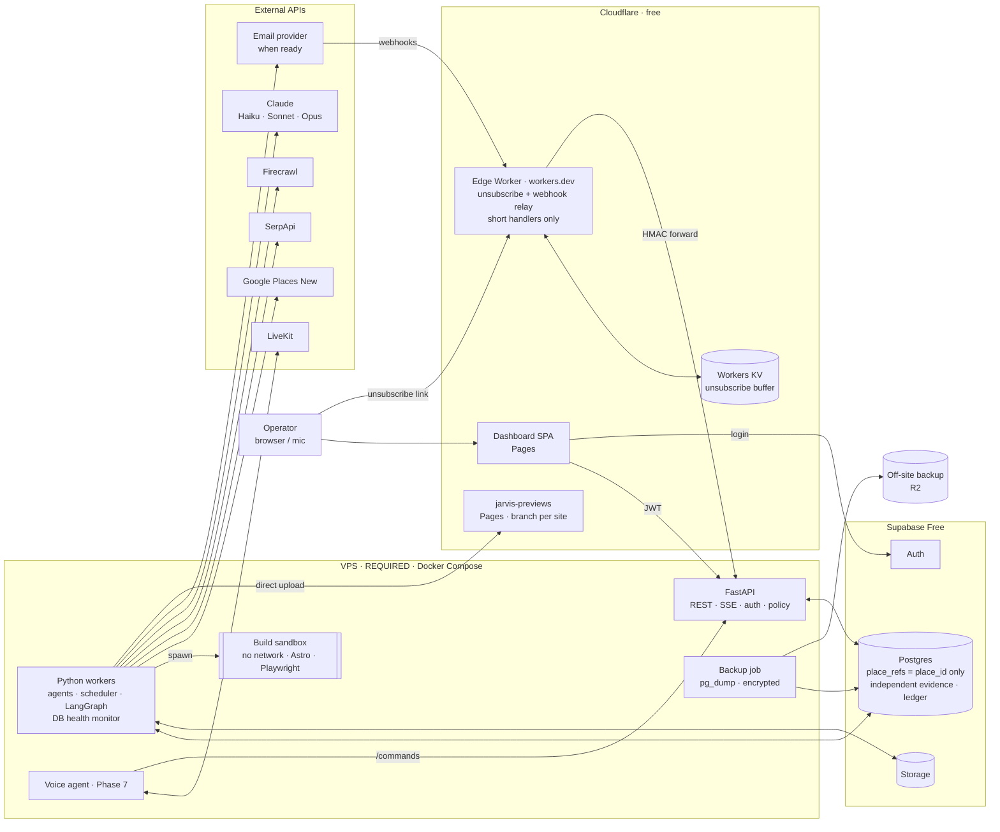
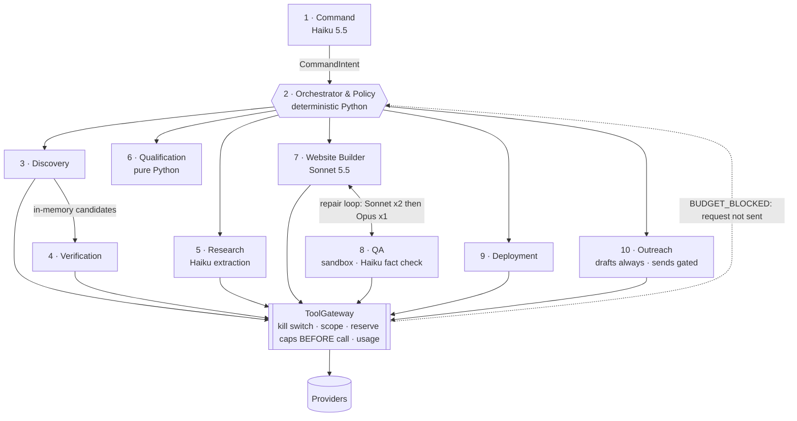
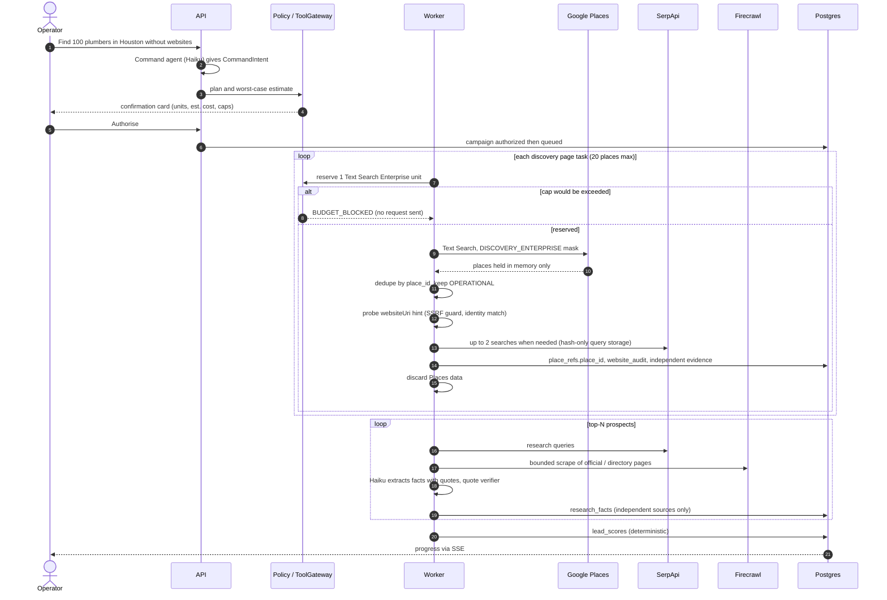
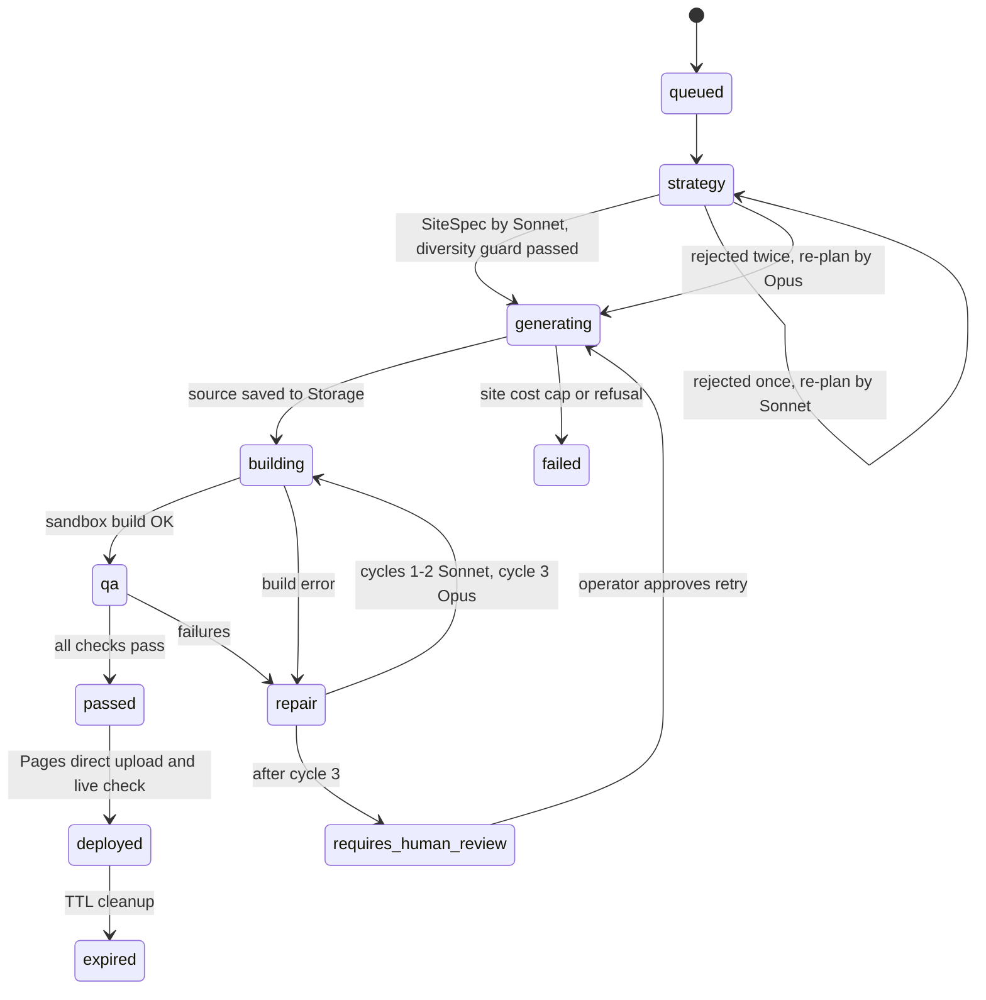
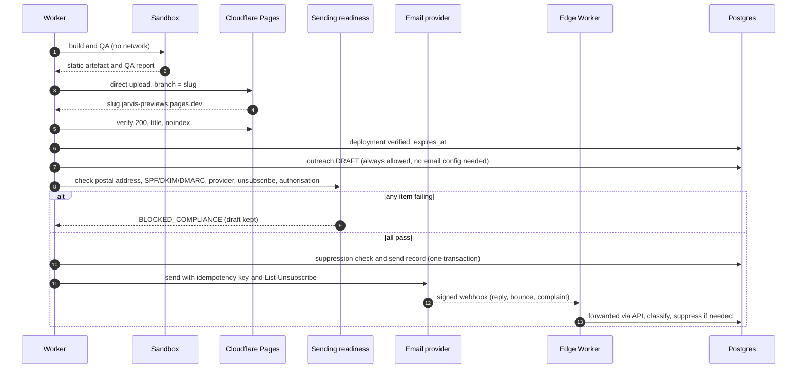

# JARVIS — System Diagrams

Revision 2. Mermaid diagrams, which render on GitHub. Changes in this revision:
- the VPS is a required component;
- Workers handle edge handlers only;
- Places content stays in memory only;
- model routing is Haiku, Sonnet, then Opus;
- a sending-readiness gate is added.

## 1. Architecture

## 2. Agent interaction

## 3. Lead generation flow

## 4. Website production flow

## 5. Deployment and outreach flow

