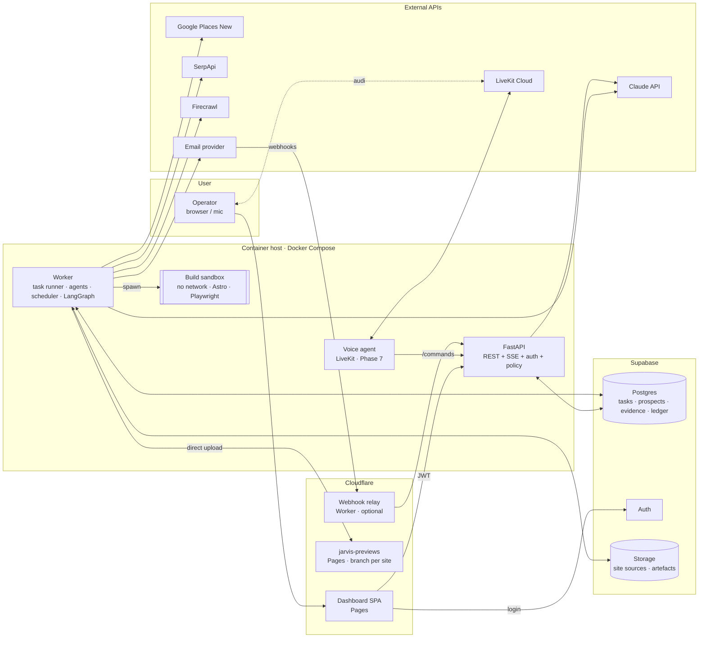
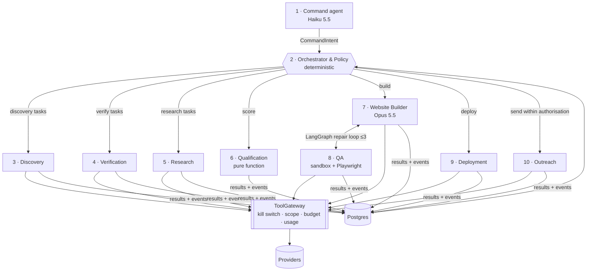
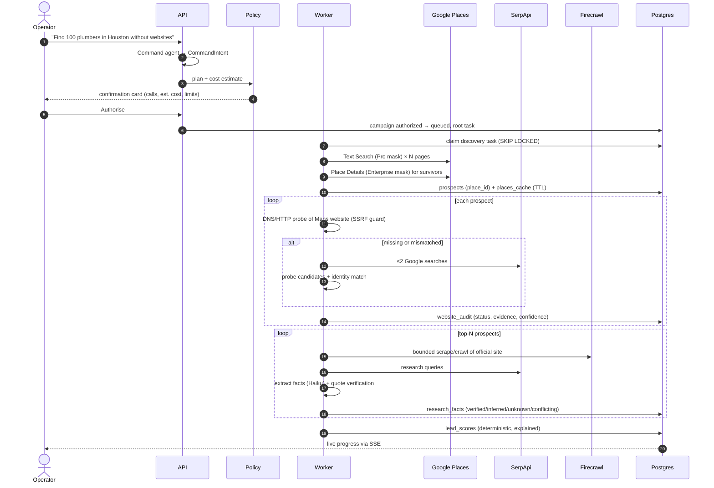
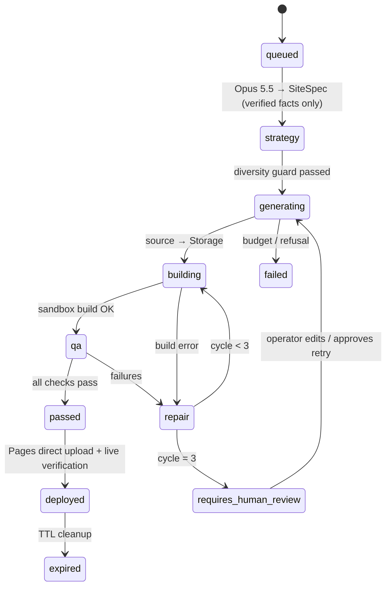
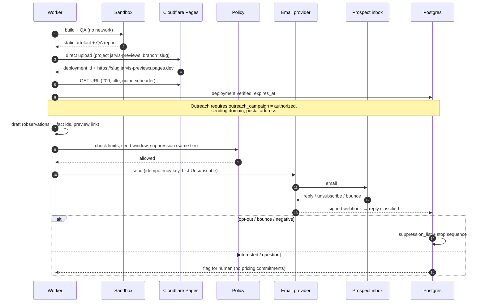

# JARVIS — System Diagrams

All diagrams are Mermaid and render on GitHub.

## 1. Architecture

## 2. Agent interaction

## 3. Lead generation flow

## 4. Website production flow

## 5. Deployment and outreach flow

