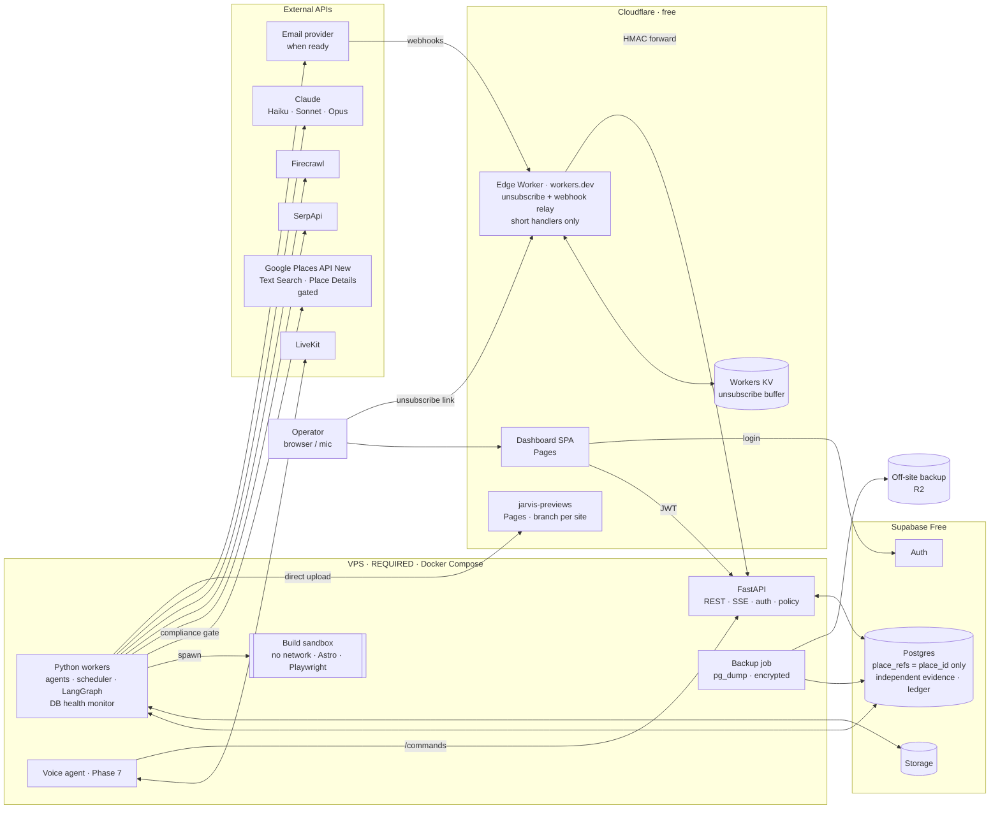
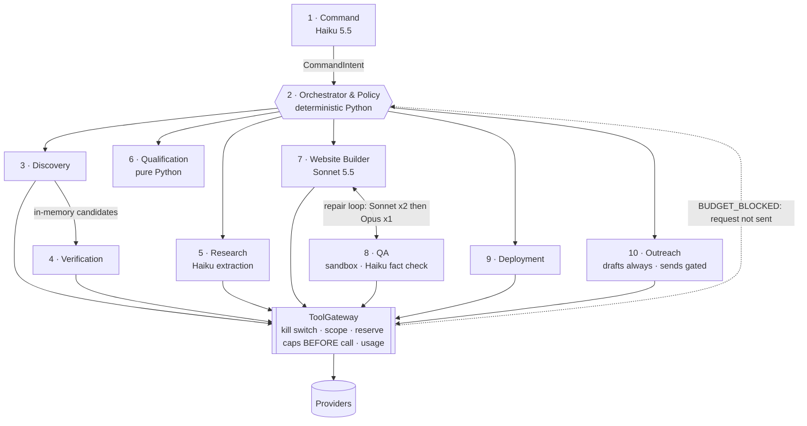
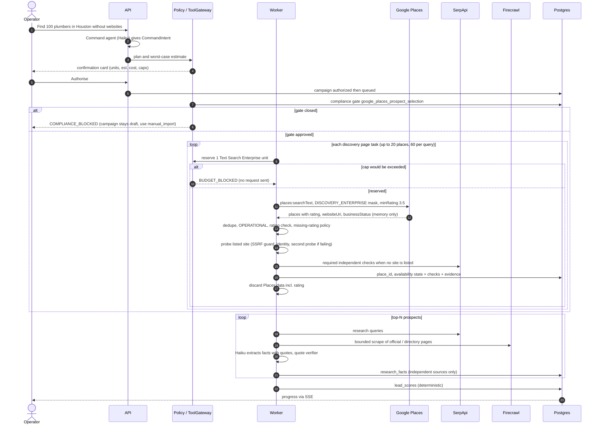
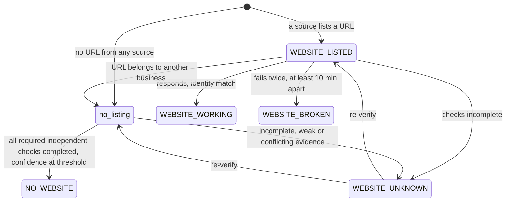
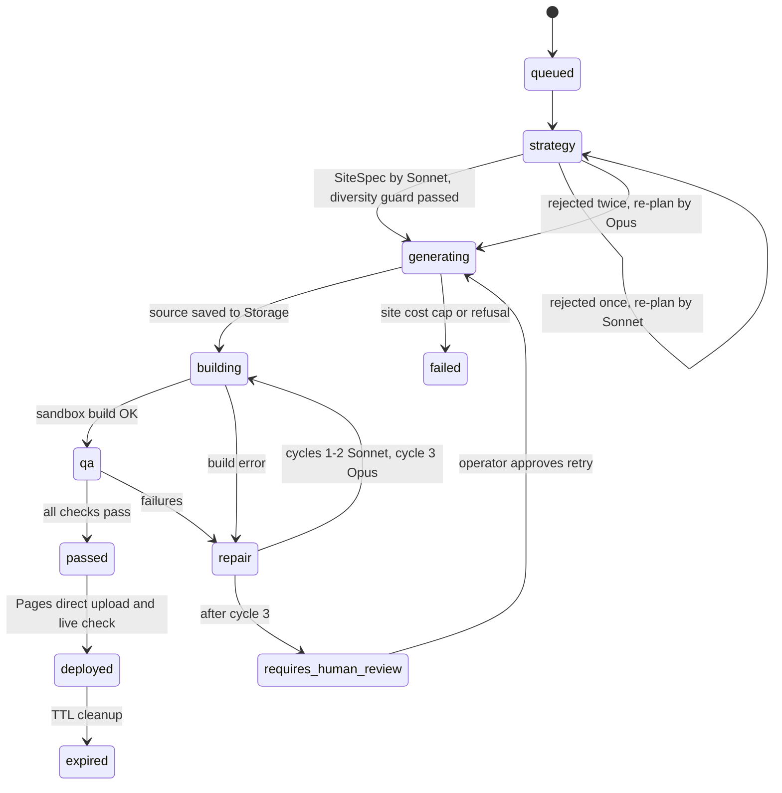
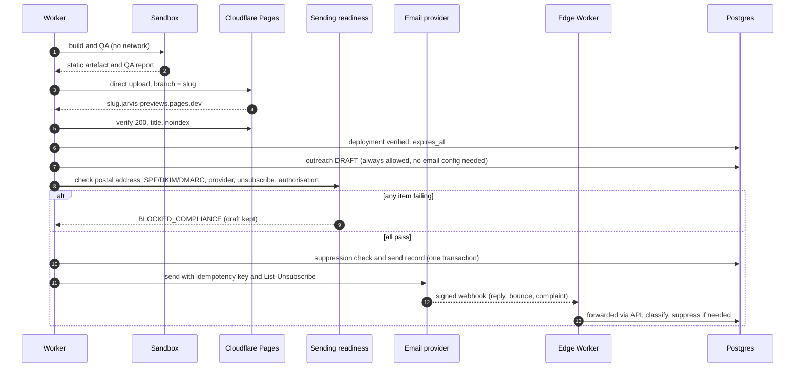

# JARVIS — System Diagrams

Revision 3. Mermaid diagrams, which render on GitHub. Revision 3 adds: the Google Places API (New) Text Search as the only Google API, the compliance gate, the rating filter, and evidence-based website states.

Revision 2 changes:
- the VPS is a required component;
- Workers handle edge handlers only;
- Places content stays in memory only;
- model routing is Haiku, Sonnet, then Opus;
- a sending-readiness gate is added.

## 1. Architecture

## 2. Agent interaction

## 3. Lead generation flow

## 4. Website availability states

`no_listing` is an in-task step, not a persisted state. A Google-only `WEBSITE_LISTED` is also resolved within the task.

## 5. Website production flow

## 6. Deployment and outreach flow

